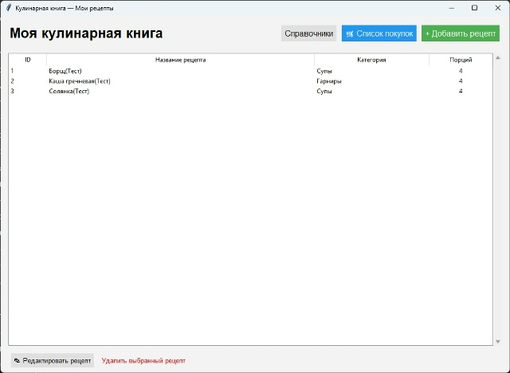

# Кулинарная книга (RecipeBook)

Учебный проект по созданию десктопного приложения для ведения личной коллекции рецептов с умной генерацией списка покупок.

## 📖 О проекте
Приложение позволяет вести базу рецептов, распределять их по категориям, добавлять ингредиенты с указанием точного количества. Главная особенность — генерация сводного списка покупок: вы выбираете несколько блюд, указываете нужное количество порций, а программа суммирует одинаковые ингредиенты и выдает готовый список для похода в магазин.

Также реализован просмотр рецептов в режиме чтения, экспорт списка покупок в текстовый файл и модуль статистики (самые популярные ингредиенты и распределение рецептов по категориям).

## 🚀 Как запустить

1. Скачайте папку с проектом (кнопка Code -> Download ZIP).
2. Убедитесь, что файлы `CulinaryBook.exe` и `init.sql` находятся в одной папке.
3. Запустите **`CulinaryBook.exe`** (или `START.bat`).
4. База данных создастся автоматически при первом запуске приложения.

## 📂 Структура проекта
* `CulinaryBook.exe` — готовое к запуску приложение.
* `init.sql` — DDL-скрипт для создания таблиц базы данных.
* `START.bat` — bat-файл для быстрого запуска программы.
* `recipe-app/` — исходный код приложения (Python):
  * `main.py` — точка входа, запуск главного окна.
  * `db.py` — подключение к SQLite.
  * `dao.py` — слой доступа к данным (CRUD и бизнес-логика).
  * `test_dao.py` — консольные тесты для демонстрации работы DAO.
  * `ui_*.py` — файлы интерфейса (справочники, рецепты, покупки, статистика, просмотр).
* `docs/uml/` — UML-диаграмма и проектирование DAO.

## 📑 Документация
* [Бриф проекта (BRIEF.md)](BRIEF.md)
* [UML Use Case диаграмма](docs/uml/use-case.png)
* [Проектирование DAO и SQL-запросы](docs/uml/dao-design.md)

## 📸 Скриншоты

*Эволюция интерфейса от макета до готового приложения:*

**Макет (проектирование):**

**Реализованное приложение:**

