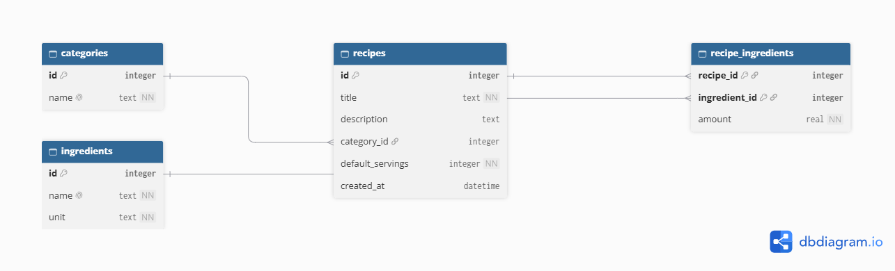

# Бриф проекта: «Кулинарная книга с умным списком покупок»

## 1. Общие сведения

**Название продукта:** «Кулинарная книга» (RecipeBook).

**Краткое описание:**
Локальное десктопное приложение для ведения личной коллекции рецептов.
Пользователь хранит рецепты с полным составом ингредиентов, а при планировании
готовки выбирает несколько блюд и получает единый список покупок с уже
просуммированными одинаковыми ингредиентами. Это избавляет от ручного
пересчёта количеств и повторяющихся позиций в списке.

**Целевая аудитория:**
Я сам и члены моей семьи — люди, которые готовят дома регулярно и хотят
держать рецепты в одном месте, а перед походом в магазин быстро получать
точный список того, что нужно купить. Дополнительно приложение подойдёт
тем, кто следит за порциями (готовит на 2, 4 или 6 человек) и хочет
пересчитывать состав без калькулятора.

---

## 2. Функциональные требования

### Обязательные (MVP)

- Пользователь может **создавать, редактировать и удалять рецепты**, указывая название, описание, категорию и число порций по умолчанию.
- Пользователь может **вести справочник категорий** (создание, переименование, удаление, просмотр списка).
- Пользователь может **вести справочник ингредиентов** (название, единица измерения: г, мл, шт. и т.п.), а также редактировать и удалять их.
- Пользователь может **формировать состав рецепта**: выбирать ингредиенты из справочника и указывать количество для каждого.
- Пользователь может **искать рецепты по названию** и **фильтровать по категории**.
- Пользователь может **масштабировать порции** рецепта: указать желаемое число порций и увидеть пересчитанные количества всех ингредиентов.
- Пользователь может **выбрать несколько рецептов и сгенерировать сводный список покупок**, в котором одинаковые ингредиенты объединяются, а количества суммируются (с учётом единиц измерения и заданного числа порций).
- Пользователь может **сохранять и распечатывать / экспортировать полученный список покупок** в текстовом виде.

### Дополнительные

- Пользователь может **отмечать шаги приготовления** как выполненные (чек-лист по шагам рецепта).
- Пользователь может **добавлять фотографию** к рецепту и видеть её в списке.
- Пользователь может **импортировать рецепт из текстового файла** простого формата и экспортировать рецепт в файл.
- Пользователь может **видеть статистику**: сколько рецептов в каждой категории, топ-5 самых используемых ингредиентов.

---

## 3. Нефункциональные требования

- **Язык интерфейса:** русский.
- **Производительность:** время отклика интерфейса при стандартных операциях (открытие списка, поиск, генерация списка покупок) — не более 1 секунды при коллекции до 1000 рецептов.
- **Хранение данных:** локально в файле базы данных SQLite. Сетевое взаимодействие не используется, приложение работает офлайн.
- **Платформа:** десктопное приложение, запускается локально.
- **Защита от ошибок:**
  - нельзя сохранить рецепт без названия;
  - нельзя указать нулевое или отрицательное количество ингредиента в составе рецепта;
  - нельзя удалить ингредиент, который используется хотя бы в одном рецепте, без явного подтверждения (с предупреждением, в скольких рецептах он используется);
  - нельзя удалить категорию, пока в ней есть рецепты (либо рецепты переносятся в «Без категории» после подтверждения);
  - при масштабировании порций число порций должно быть целым и больше нуля.
- **Инициализация БД:** при первом запуске приложение само создаёт файл БД и все таблицы из встроенного SQL-скрипта, а также наполняет справочник единиц измерения базовым набором.
- **Устойчивость:** все изменения, затрагивающие несколько таблиц (например, сохранение состава рецепта), выполняются в рамках транзакции.

---

## 4. Модель данных (ER-диаграмма)

### Таблицы



**categories** — категории рецептов
| Поле | Тип | Ключ |
|------|-----|------|
| id | INTEGER | PK |
| name | TEXT NOT NULL UNIQUE | |

**recipes** — рецепты
| Поле | Тип | Ключ |
|------|-----|------|
| id | INTEGER | PK |
| title | TEXT NOT NULL | |
| description | TEXT | |
| category_id | INTEGER | FK → categories(id) |
| default_servings | INTEGER NOT NULL CHECK(>0) | |
| created_at | DATETIME | |

**ingredients** — справочник ингредиентов
| Поле | Тип | Ключ |
|------|-----|------|
| id | INTEGER | PK |
| name | TEXT NOT NULL UNIQUE | |
| unit | TEXT NOT NULL | |

**recipe_ingredients** — состав рецепта (M:N)
| Поле | Тип | Ключ |
|------|-----|------|
| recipe_id | INTEGER | PK, FK → recipes(id) ON DELETE CASCADE |
| ingredient_id | INTEGER | PK, FK → ingredients(id) |
| amount | REAL NOT NULL CHECK(amount > 0) | |

Составной первичный ключ: **(recipe_id, ingredient_id)**.

### Связи

- `categories 1 —— N recipes` — у одной категории много рецептов; у рецепта одна категория (или NULL).
- `recipes M —— N ingredients` через `recipe_ingredients` — в рецепте много ингредиентов, ингредиент входит во многие рецепты.

### Обоснование нормализации

- **Ингредиенты вынесены в отдельный справочник**, чтобы не дублировать название и единицу измерения в каждом рецепте и обеспечить корректное объединение при генерации списка покупок (сравнение идёт по `ingredient_id`, а не по строке).
- **Таблица `recipe_ingredients`** реализует связь M:N и хранит атрибут связи — количество. Без неё нельзя было бы указать «сколько» ингредиента нужно.
- **Категории в отдельной таблице**, а не строкой в рецепте, — для фильтрации, переименования категории одним действием и предотвращения опечаток.
- Все таблицы приведены к **3-й нормальной форме**: нет транзитивных зависимостей, неключевые поля зависят только от первичного ключа.

### SQL-скрипт создания (эскиз)

```sql
CREATE TABLE categories (
    id   INTEGER PRIMARY KEY AUTOINCREMENT,
    name TEXT NOT NULL UNIQUE
);

CREATE TABLE recipes (
    id               INTEGER PRIMARY KEY AUTOINCREMENT,
    title            TEXT NOT NULL,
    description      TEXT,
    category_id      INTEGER REFERENCES categories(id) ON DELETE SET NULL,
    default_servings INTEGER NOT NULL CHECK (default_servings > 0),
    created_at       DATETIME DEFAULT CURRENT_TIMESTAMP
);

CREATE TABLE ingredients (
    id   INTEGER PRIMARY KEY AUTOINCREMENT,
    name TEXT NOT NULL UNIQUE,
    unit TEXT NOT NULL
);

CREATE TABLE recipe_ingredients (
    recipe_id     INTEGER NOT NULL REFERENCES recipes(id) ON DELETE CASCADE,
    ingredient_id INTEGER NOT NULL REFERENCES ingredients(id),
    amount        REAL NOT NULL CHECK (amount > 0),
    PRIMARY KEY (recipe_id, ingredient_id)
);
